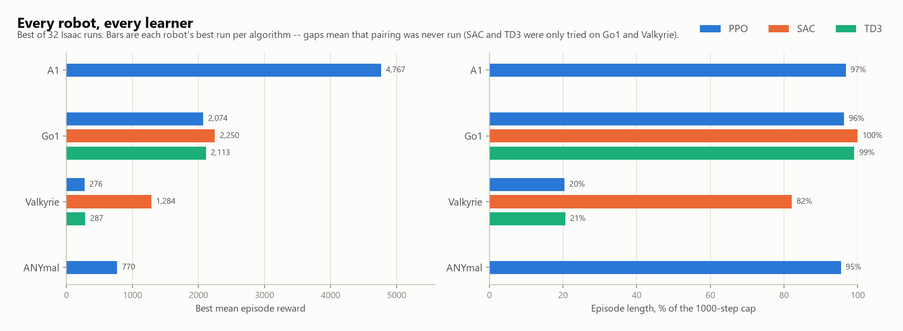
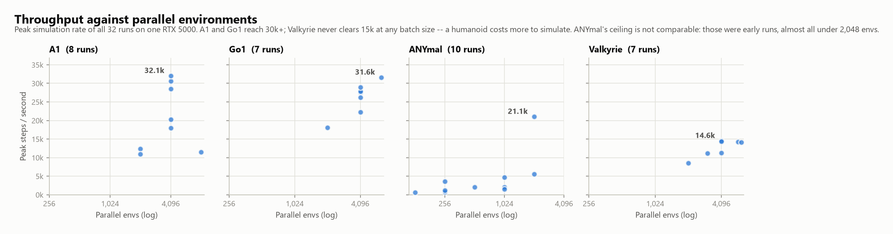
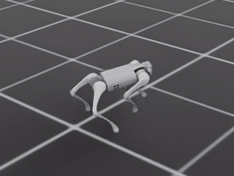
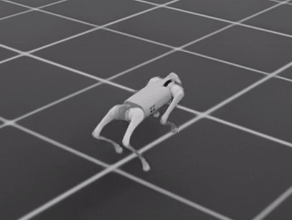
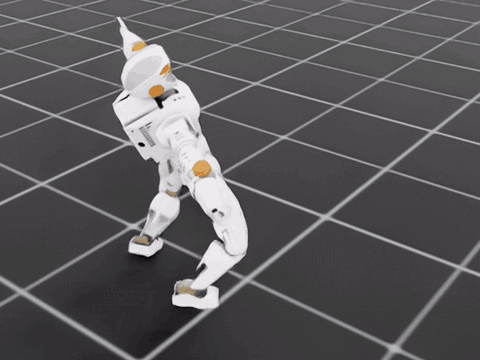
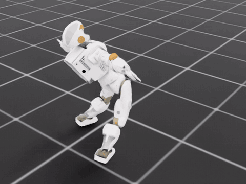
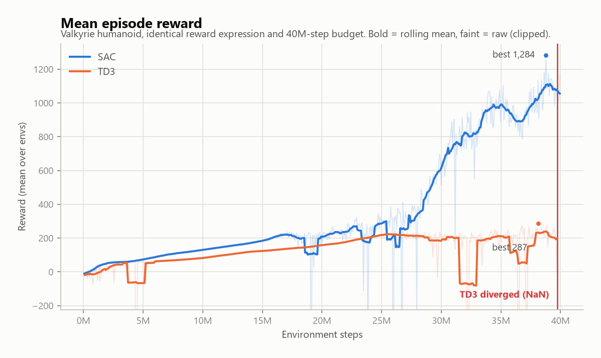
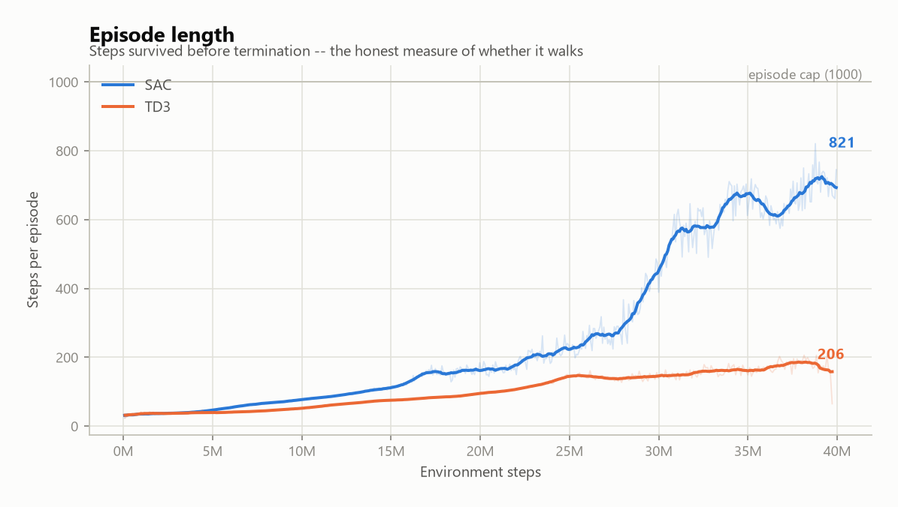
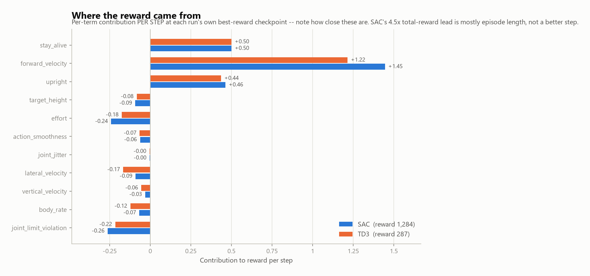

# EasyRTG

A single-user desktop **reinforcement-learning training ground for URDF robots**. Load a robot
file, describe the behaviour you want in plain language, and an in-app LLM agent writes the reward
expression, calibrates the stance, and launches massively-parallel GPU training. Watch it learn
live, then replay the recorded policy.

Training and evaluation run on the **NVIDIA Isaac Sim GPU lane** — thousands of robot instances
stepping in parallel on one GPU. PyBullet is kept headless for URDF inspection, reward testing and
tuning; it never trains.

---
## Results

**32 Isaac training runs across 4 robots.** Peak simulation throughput **32,057 environment steps
per second** on one RTX 5000; best policy **4,767 mean episode reward** (PPO on the Unitree A1,
97% of the episode cap). Every number below is recomputed from the run directories' `telemetry.jsonl`
by [`scripts/make_readme_media.py`](scripts/make_readme_media.py) — nothing is quoted by hand.



**The quadrupeds are solved; the humanoid is the open problem.** A1, Go1 and ANYmal all reach
95–100% of the 1,000-step episode cap — they walk, and they keep walking until the episode ends.
Valkyrie only gets there with SAC (82%); PPO and TD3 both stall near 20%, falling over in a fifth
of an episode. SAC and TD3 were only ever run on Go1 and Valkyrie, which is why those rows have
three bars and the others one.



Throughput is set by two things: how many environments run in parallel, and what the robot costs to
simulate. A1 and Go1 clear 30k steps/s at 4,096 envs; Valkyrie never clears 15k at any batch size.
ANYmal's lower ceiling is not a fair comparison — those were early runs, almost all under 2,048
envs.

### Quadruped — Go1

Both reach the episode cap and hold a stable trot. Different learners, same outcome.

| SAC — reward 2,250 | PPO — reward 2,074 |
|---|---|
|  |  |
| 100% of episode cap | 96% of episode cap |

### Humanoid — Valkyrie

Same robot, same reward expression, same 40M-step budget. The difference is the learner.

| SAC — reward 1,284 | TD3 — reward 287 |
|---|---|
|  |  |
| Upright, sustained stride, 82% of cap | Hunched, 21% of cap, later diverged |



The two track each other for 25M steps, then separate: SAC climbs to 1,284 while TD3 plateaus near
200. At 39.7M steps the TD3 run died on NaN observations — its reward terms had blown up by eleven
orders of magnitude, `forward_velocity` reaching −2.8 × 10¹¹. The same reward expression trained
SAC to 1,284 without incident, which points at the critic rather than the reward.





The part worth knowing: **per step, the two policies score almost the same.** SAC's
forward-velocity term is 1.45 against TD3's 1.22 and the penalties are within hundredths of each
other. So SAC's 4.5× total-reward lead is not a better step — it is four times as many steps before
falling over. Reward curves without episode length beside them will mislead you about exactly this.

Regenerate every asset above:

```bash
uv run --python 3.12 --with matplotlib --with numpy --with pillow --with scipy python scripts/make_readme_media.py
```

---

## How it works

**Rewards are expressions, not a menu.** There is no catalogue of named reward components. Every
term is an expression over a shared state vocabulary — `mean(contact)`, `height_ratio`, `upright`,
`forward_velocity` — evaluated identically by the PyBullet test lane at N=1 and by Isaac at N=4096.
So "Test reward" checks exactly what training will optimise. Vector widths come from the robot, so
`mean(contact)` ports from a quadruped to a biped untouched.

**Morphology is derived from the URDF, not from joint names.** Limb structure, contact links,
stance and spawn height are computed from the kinematic tree, so a robot the app has never seen
gets a sane starting pose rather than a hard-coded one.

**The agent drives the pipeline.** An LLM agent (local Ollama, or any OpenAI-compatible endpoint)
authors reward expressions and training configs through tool calls, and the Flutter app shows the
audit verdict for each term beside the expression as you edit it.

| Path | What lives there |
|---|---|
| `backend/` | FastAPI orchestration, PyBullet inspection world, Isaac subprocess lane, RL, LLM agent |
| `frontend/rtg-flutter-app/` | Flutter desktop app — the only UI |
| `docs/` | [Architecture notes](docs/architecture_notes.md), [API](docs/api.md), [Isaac setup](docs/isaac_setup.md), design records |
| `scripts/` | Launchers, build, and this README's asset generator |
| `smoke_runs/` | Committed Isaac reference runs — healthy vs free-falling spawn, for regression comparison |

Start with **[docs/architecture_notes.md](docs/architecture_notes.md)** before any nontrivial
change; it is the map of where the sharp edges are.

---

## Setup

Requires **Python 3.12**, an **NVIDIA GPU**, and **Isaac Sim 6.0.1 + Isaac Lab 3.0** for training.
The backend and UI run without Isaac — you just can't train.

### Backend

The environment is managed with [uv](https://docs.astral.sh/uv/) and has **no `pip` module**;
install through uv from outside the venv.

```powershell
uv venv --python 3.12 .venv
uv pip install --python .\.venv\Scripts\python.exe -r backend\requirements.txt
```

Start the supervised backend (auto-restarts on a PyBullet/EGL segfault):

```powershell
.\scripts\start_backend.ps1
```

On Linux use `./scripts/start_backend.sh`. If PowerShell blocks the script, run it once with
`powershell -ExecutionPolicy Bypass -File .\scripts\start_backend.ps1`.

> **ROS PYTHONPATH leak.** If ROS 2 or Gazebo is sourced in your shell it injects a Python 3.14
> `site-packages` onto `PYTHONPATH`, which shadows the 3.12 venv with ABI-incompatible builds and
> breaks imports and pytest. Prefix commands with `env -u PYTHONPATH` (the shell launchers already
> unset it).

### Desktop app

Flutter needs the **Desktop development with C++** workload from Visual Studio on Windows, or
`clang cmake ninja-build pkg-config libgtk-3-dev` on Ubuntu/Debian. Confirm with `flutter doctor`.

```powershell
cd frontend\rtg-flutter-app
flutter pub get
flutter run -d windows
```

Or run backend and app together from the repo root:

```powershell
.\scripts\dev_run.ps1
```

The app auto-spawns the backend on `http://127.0.0.1:8000` if it isn't already answering, so a
manually started backend and the app's auto-start never conflict.

### Isaac Sim

Isaac Sim runs as a **separate subprocess under its own bundled Python** (`C:\isaacsim\python.bat`)
— it cannot be embedded in the backend process — and writes into the same `runs/<timestamp>/`
telemetry layout as everything else. Setup progress and gotchas: **[docs/isaac_setup.md](docs/isaac_setup.md)**.

Evaluation has two modes, picked per run:

- **Record video** — headless, produces `eval_video.mp4` with a chase camera locked to the robot,
  played in-app with seek and save-a-copy. Every past recording stays replayable from the Evaluate
  tab. This is the fully in-app 3D view.
- **Watch live** — launches NVIDIA's standalone **Isaac Sim WebRTC Streaming Client** against
  `127.0.0.1:49100`. It cannot be embedded in-app on Windows: NVIDIA's in-browser client is a
  Docker web viewer supported only on Ubuntu/DGX.

### Tests

```powershell
$env:PYTEST_DISABLE_PLUGIN_AUTOLOAD=1; .\.venv\Scripts\python.exe -m pytest backend\tests\ -q --basetemp=.pytest_tmp
```

`--basetemp` is required on Windows. For the UI: `flutter analyze && flutter test`.

---

## First run

1. Start the backend and the desktop app.
2. Load a `.urdf` in the Robot Inspector. Check that observations and actions report non-zero
   vector sizes.
3. Tell the agent what you want the robot to do. It writes the reward expression and config.
4. Press **Test reward** to evaluate the expression at N=1 before committing GPU hours.
5. Launch Isaac training. Watch telemetry live, or open the 3D page for a live view.
6. Results land in `backend/runs/<timestamp>-isaac/` — `config.json`, `telemetry.jsonl`,
   `training_log.txt`, checkpoints, and `eval_video.mp4`.

## Limitations

- **Observations are a fixed catalogue of 7 keys**, unlike rewards. Isaac computes `obs_dim`
  statically to feed rsl_rl's `observation_space`, so expression observations would mean a retrain
  for no gait benefit.
- **Configs saved before 2026-07-29 are untrainable.** The expression cutover was a hard cut with
  no translation shim — bare reward keys now fail loudly and must be re-authored. Two live reward
  paths is the thing that rots.
- Five reward keys are **PyBullet-only** (`target_base_position`, `target_link_position`,
  `action_magnitude`, `falling_height`, `forbidden_contacts`); the Isaac lane rejects them. They
  reference link positions and target vectors the shared vocabulary does not expose yet.
- Per-episode commands are not in the state vocabulary yet, so no velocity-command tracking.
- Camera-image observations are placeholders. Multi-agent RL, ROS and Gazebo are not included.
- Training quality depends heavily on URDF quality; some robots need manual stance calibration.

## Licence

See [LICENSE](LICENSE).
